# Análisis del proyecto ACO-Rutas

## ¿Qué queríamos resolver?

En este proyecto tenemos 12 clientes ubicados en un mapa. La idea es encontrar una ruta para que un repartidor pase por todos y vuelva al punto donde empezó, pero tratando de recorrer la menor distancia posible.

Para comparar diferentes formas de hacerlo, probamos tres métodos:

- **Manual:** visitar a los clientes siguiendo el mismo orden en el que aparecen en la base de datos. Básicamente, es hacer la ruta sin organizarla antes.
- **Vecino más cercano:** desde el punto donde se encuentra, el repartidor va al cliente pendiente que esté más cerca.
- **ACO (colonia de hormigas):** funciona tomando como ejemplo el comportamiento de las hormigas. Varias de ellas prueban diferentes caminos y van dejando feromonas en las rutas que les dieron mejores resultados. Luego, otras hormigas tienen más posibilidades de pasar por esos caminos. Después de varias pruebas, la idea es que se vayan encontrando recorridos más cortos.

Como ACO tiene un componente aleatorio, no siempre encuentra exactamente la misma ruta. Por eso lo ejecutamos 30 veces, para mirar qué resultados daba y si cambiaban mucho. Guardamos cada ejecución en SQL Server, en la tabla `Ejecuciones`, y con esos datos hicimos las tablas y gráficas que aparecen más adelante.

## Cómo preparamos el entorno

Antes de correr cualquier experimento tuvimos que montar la base de datos y conectar Python con ella. Estos fueron los pasos.

### 1. Fork del repositorio

Partimos del repositorio original de nuestra compañera e hicimos un fork: [alejandrapaipilla8-boop/Proyecto-ACO-Rutas](https://github.com/alejandrapaipilla8-boop/Proyecto-ACO-Rutas).

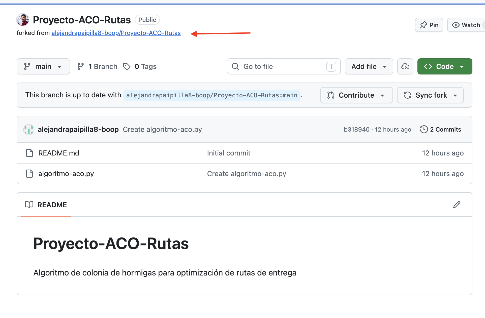

### 2. Instalar SQL Server con Docker

En macOS no se puede instalar SQL Server directamente, así que lo corrimos dentro de un contenedor de Docker. Un detalle: la Mac tiene un procesador M4 (ARM) y Microsoft solo publica la imagen de SQL Server para `linux/amd64`. Por eso hay que agregar `--platform linux/amd64`, y Docker la ejecuta emulada. Funciona sin problema, solo que es un poco más lenta que en un equipo Intel.

```bash
docker run --platform linux/amd64 \
  -e 'ACCEPT_EULA=Y' \
  -e 'MSSQL_SA_PASSWORD=Password123!Aa' \
  -p 1433:1433 \
  --name sqlserver_contenedor \
  -d mcr.microsoft.com/mssql/server:2022-latest
```

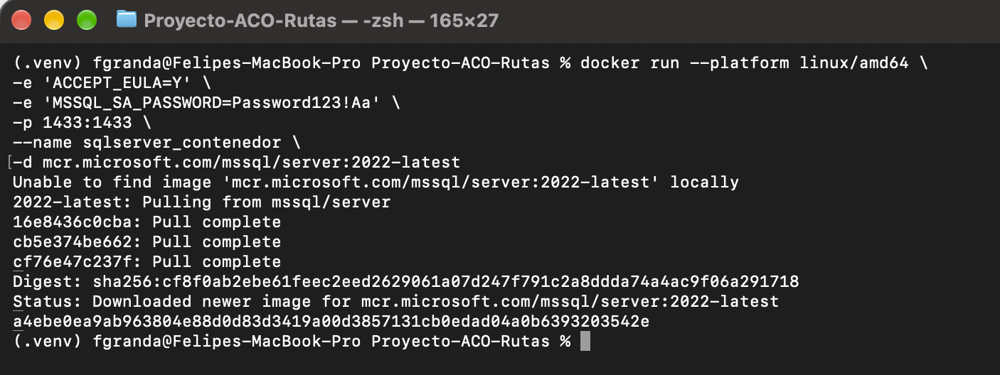

### 3. Instalar SQLAlchemy

Usamos SQLAlchemy para no escribir SQL a mano en cada consulta. Con él trabajamos con clases de Python y la librería se encarga de traducirlas a SQL.

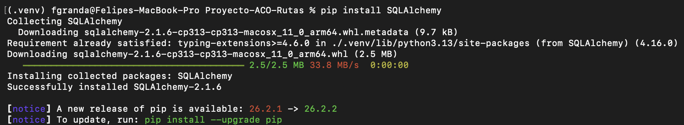

### 4. Archivo de conexión

En `sql_auth.py` creamos la conexión a SQL Server usando el driver `pyodbc` (ODBC Driver 18).

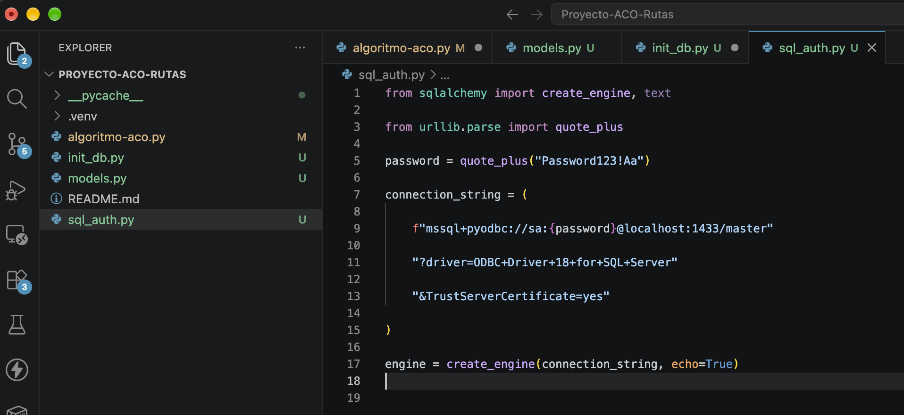

> **Ojo en Mac:** el driver ODBC 18 necesita OpenSSL 3. Si Homebrew tiene instalada una versión más nueva, la conexión falla con el error *"OpenSSL library could not be loaded"*. Se arregla así:
> `export DYLD_LIBRARY_PATH=/opt/homebrew/opt/openssl@3/lib`

### 5. Modelo de clientes

En `models.py` definimos la tabla `Clientes` como una clase, con un id y las coordenadas x e y de cada cliente.

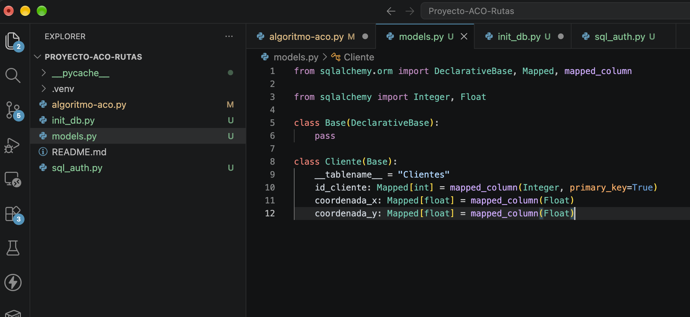

### 6. Crear la tabla

Ejecutamos `init_db.py`, que toma el modelo y crea la tabla en SQL Server.

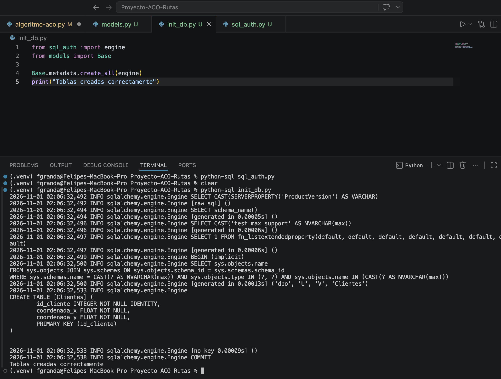

### 7. Cargar los clientes

Con `escribir.py` insertamos las 12 coordenadas que nuestra compañera había definido en la versión original del código.

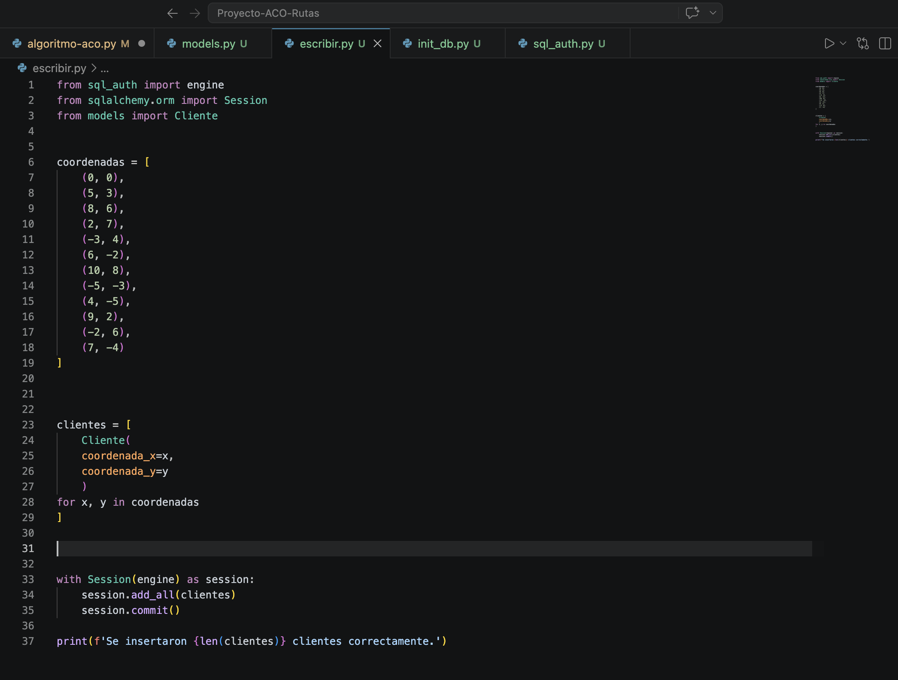

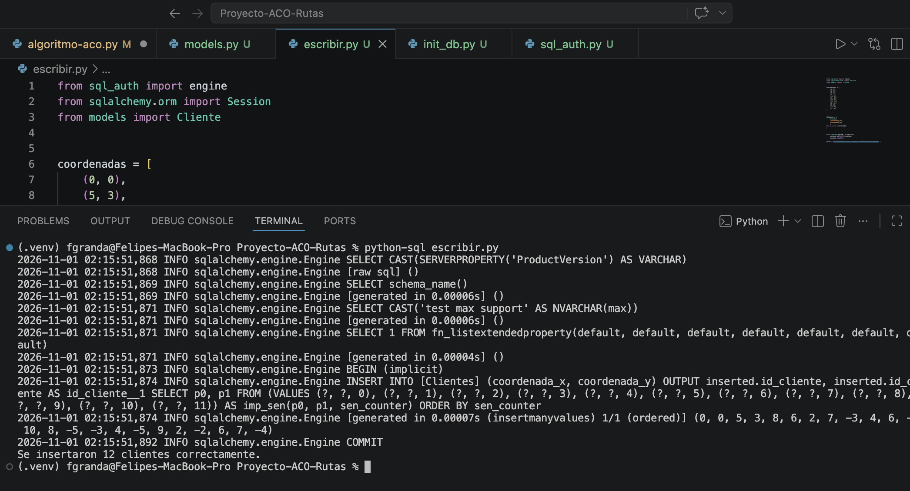

La tabla `Ejecuciones`, donde se guardan los resultados de cada corrida, no hace falta crearla a mano: `experimentos.py` la crea automáticamente la primera vez que se ejecuta.

## Resultados

| Método | Distancia promedio | Variación (desviación estándar) | Tiempo promedio | Ahorro frente a la ruta manual |
|---|---|---|---|---|
| **ACO** | **54,46 km** | 0,14 km | 15,7 ms | **51,9 %** |
| Vecino más cercano | 58,65 km | 0 (siempre da lo mismo) | 0,01 ms | 48,2 % |
| Manual | 113,22 km | 0 | ~0 ms | — |

> Para hacer más fácil la lectura de los resultados, tomamos cada unidad del mapa como si fuera 1 km.

Al revisar los resultados, encontramos varias cosas:

- La diferencia frente a la ruta manual es bastante grande. Incluso usando el método más sencillo, el de vecino más cercano, se reduce casi a la mitad la distancia.
- ACO consiguió rutas más cortas que el vecino más cercano en las 30 pruebas. La diferencia fue de unos 4 km, aproximadamente un 7 %.
- Los resultados de ACO no cambiaron mucho entre las ejecuciones. En 28 de las 30 pruebas (93 %) encontró la misma ruta de 54,43 km.
- ACO se demora más en hacer el cálculo. En promedio tardó unas 1.300 veces más que el vecino más cercano. Aunque la diferencia parece grande, en realidad son alrededor de 16 milisegundos, así que para 12 clientes no es algo que afecte demasiado.

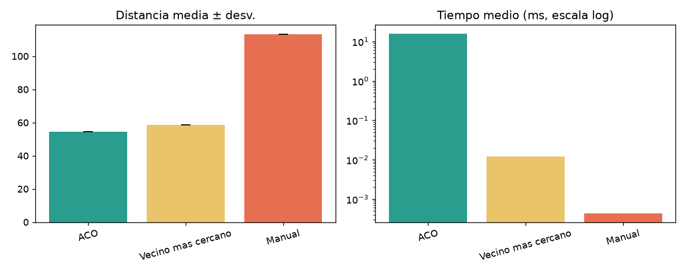

En la gráfica de la izquierda se comparan las distancias promedio. Se puede ver que ACO y vecino más cercano quedan relativamente cerca, mientras que la ruta manual es mucho más larga. En la gráfica de la derecha se muestra el tiempo que tarda cada método. Se usó una escala logarítmica porque la diferencia entre los tiempos es tan grande que, con una escala normal, algunas barras casi no se alcanzarían a ver.

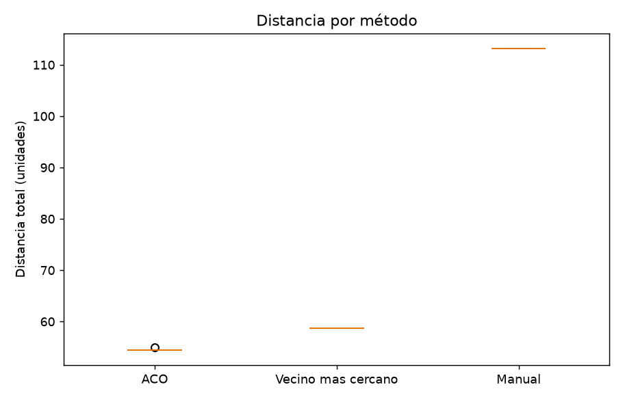

En esta gráfica las cajas casi no se alcanzan a notar porque los resultados fueron muy parecidos. En el caso de ACO aparecen dos puntos un poco más altos. Esas fueron las dos ejecuciones en las que no se encontró la ruta de 54,43 km.

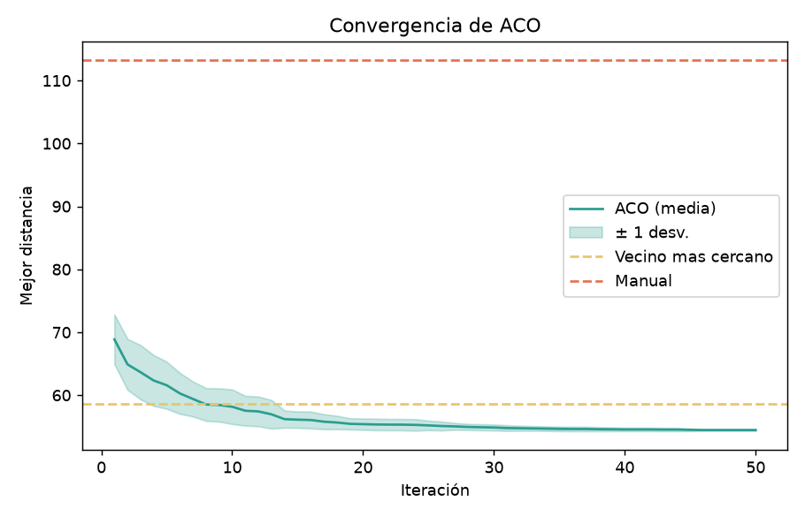

Aquí se muestra cómo van cambiando las rutas de ACO durante las iteraciones. Al comienzo, las rutas son más largas que la del vecino más cercano (línea amarilla). Más o menos entre las iteraciones 8 y 10, ACO empieza a encontrar rutas más cortas. Después de la iteración 30, la mejora ya es muy pequeña. Para este ejemplo, parece que no sería necesario hacer muchas más iteraciones.

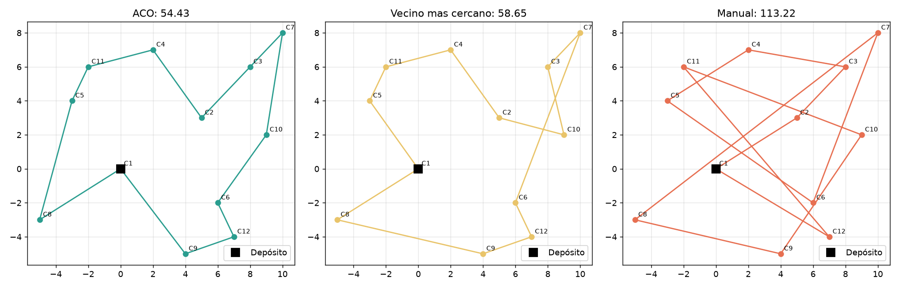

En esta última gráfica se pueden ver los recorridos de cada método. La ruta manual pasa varias veces de un lado al otro del mapa. El vecino más cercano va haciendo un recorrido más organizado, pero al final tiene que hacer un salto largo desde C10 hasta C7 y volver hacia abajo. ACO encontró una ruta más corta y con menos cruces.

## ¿Qué pasaría si se usara en una empresa?

### Impacto ambiental

Para tener una idea del posible impacto, hicimos un cálculo suponiendo que un vehículo realiza esta ruta una vez al día durante un año laboral, es decir, 260 días. También usamos como referencia que un camión diésel emite aproximadamente 0,25 kg de CO₂ por cada kilómetro recorrido.

| Método | Km ahorrados al año | CO₂ evitado al año |
|---|---|---|
| ACO | ~15.300 km | ~3.800 kg |
| Vecino más cercano | ~14.200 km | ~3.500 kg |

Los números se ven bastante bien, pero hay que tener presente que son una estimación y que parten de una comparación que no necesariamente representa lo que pasa en una empresa:

- La ruta manual que usamos es bastante larga. En la práctica, un repartidor que ya conoce la zona seguramente organizaría mejor sus recorridos. Por eso, el ahorro real podría ser menor.
- Gran parte del ahorro se consigue simplemente por organizar la ruta. La diferencia entre ACO y vecino más cercano es de unos 300 kg de CO₂ al año.
- También puede pasar que la empresa use el tiempo que se ahorra para asignar más entregas. En ese caso, el vehículo podría terminar recorriendo una distancia similar o incluso mayor.

### Impacto en el trabajo

Por un lado, recorrer menos kilómetros podría significar menos tiempo conduciendo y menos cansancio para el repartidor. También se reduciría el tiempo que se necesita para organizar las rutas.

Pero hay otros temas que no se deberían dejar de lado:

- La empresa podría aprovechar que las rutas son más rápidas para exigir más entregas durante el mismo turno, en vez de mejorar las condiciones de trabajo.
- Si el sistema organiza las rutas automáticamente, la persona que antes hacía esa tarea podría dejar de ser necesaria.
- El repartidor conoce detalles de la zona que el programa no tiene cómo saber por sí solo. Por ejemplo, hay calles que se inundan, lugares donde no es fácil estacionar o clientes que solo reciben pedidos en la mañana. Si tiene que seguir la ruta tal como la entrega el sistema, esos detalles podrían quedar por fuera.

Por eso, sería mejor que el programa proponga una ruta y que el repartidor pueda cambiarla cuando sea necesario, en lugar de obligarlo a seguirla exactamente.

### Privacidad y seguridad de los datos

En este ejercicio usamos coordenadas inventadas, pero en una aplicación real podrían ser las direcciones de personas. Al guardar las rutas y los horarios de entrega también se podría conocer dónde vive alguien y en qué momento suele recibir pedidos.

Antes de usar datos reales, habría que revisar algunas cosas del proyecto:

- La contraseña de la base de datos está escrita directamente en `sql_auth.py`. Sería mejor guardarla en una variable de entorno y no dejarla dentro del código.
- La conexión se está haciendo con el usuario administrador (`sa`) y con la base de datos `master`. Para el proyecto sería mejor tener una base de datos propia y un usuario que solo tenga los permisos que necesita.
- También falta definir quién puede consultar las rutas y por cuánto tiempo se van a guardar.

## Limitaciones y cosas que se podrían mejorar

El proyecto sirve para probar los métodos, pero todavía está lejos de representar todo lo que pasa en una operación real de entregas. Por ejemplo:

| Limitación | ¿Qué problema tiene? | ¿Qué se podría hacer? |
|---|---|---|
| Medimos las distancias en línea recta | Los vehículos no pueden atravesar edificios ni tomar cualquier camino. También hay semáforos y vías de un solo sentido. | Usar distancias calculadas sobre las calles, por ejemplo, con OSRM o Google Maps. |
| Solo usamos un vehículo y no tiene límite de carga | En una empresa puede haber varios vehículos y cada uno tiene una capacidad diferente. | Probar el problema con varios vehículos (VRP). |
| Solo buscamos reducir los kilómetros | No estamos teniendo en cuenta el tráfico, los horarios de los clientes o cuáles entregas son más urgentes. | Incluir tiempos de recorrido y horarios de entrega. |
| La ruta manual es bastante larga | Comparar contra una ruta tan poco eficiente puede hacer que el ahorro parezca mayor. | Hacer pruebas con rutas que se utilicen realmente en una empresa. |
| Solo probamos con 12 clientes | No sabemos cuánto tardaría el algoritmo con 100 o 500 clientes. | Aumentar la cantidad de clientes y revisar cómo cambian los resultados y los tiempos. |
| No comprobamos si 54,43 km es la mejor ruta posible | ACO encuentra rutas buenas, pero eso no significa que sean las mejores que existen. | Comparar el resultado con un método exacto. Para 12 clientes todavía sería posible hacerlo. |
| Los parámetros de ACO se eligieron manualmente | No sabemos si otros valores podrían dar un mejor resultado. | Probar diferentes combinaciones de parámetros. |
| Algunos clientes lejanos podrían quedar al final | Si esto se repite, los mismos clientes podrían recibir sus pedidos más tarde. | Agregar alguna forma de distribuir mejor los horarios de entrega. |

## Para cerrar

Con las pruebas que hicimos, ACO fue el método que consiguió la ruta más corta y sus resultados fueron bastante parecidos en las 30 ejecuciones. También hay que decir que tardó más que el vecino más cercano, aunque para este ejemplo el tiempo sigue siendo muy pequeño.

Algo que me quedó claro al comparar los tres métodos es que no siempre se necesita un algoritmo complejo para mejorar un recorrido. El vecino más cercano ya consiguió reducir bastante la distancia frente a la ruta manual. ACO logró mejorar ese resultado un poco más, así que puede ser una alternativa interesante si se trabaja con más clientes o si se necesita aprovechar mejor cada kilómetro.

De todas formas, para pensar en usarlo en una empresa todavía habría que hacer pruebas con calles reales, varios vehículos y horarios de entrega. También sería necesario mejorar la forma en que se guardan y protegen los datos de los clientes.
